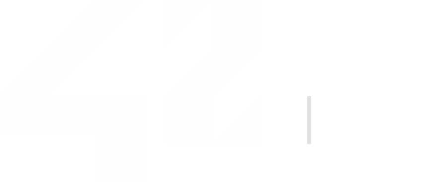

# 👋 Hi, I'm Wael Chatoui

🎯 **Computer Science student** from France, focused on building scalable and elegant solutions.  
💡 Passionate about **clean code**, **automation**, and **working with big code bases**

---

## 🧩 Tech Stack

  

---

## 🚀 About Me

  

- 🎓 Studying **Computer Science** at **[42 School](https://42.fr/)**  
- 🚧 Je travaille en ce moment sur le **Common Core de l'école 42**.
- 🌱 Je suis en train d'apprendre **LangChain** et **LangGraph**.
- 💼 Je suis actuellement à la recherche d'un **CDI**.
- 💻 Passionate about **Backend**, **DevOps**, and **Cloud Engineering**  
- 🧠 Always exploring **system design** and **performance optimization**  
